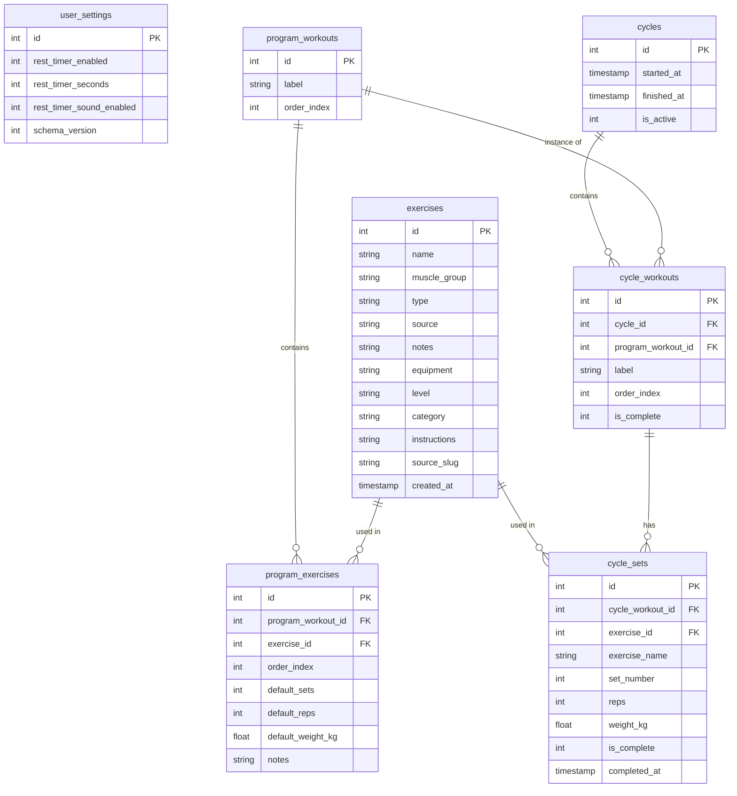

# Database Schema

## ER Diagram

---

## Core concept

The **program** is the repeating structure — a fixed, ordered list of workouts (e.g. "Push", "Pull", "Legs") that the user defines once and reuses. It is NOT tied to calendar days.

A **cycle** is one live run through the program. Only one cycle is active at a time. Starting a cycle stamps out a `cycle_workouts` row for every `program_workouts` row, each pre-seeded with blank `cycle_sets` rows based on `program_exercises` defaults. The user checks off sets and workouts as they train. Pressing "New Cycle" (available at any time, not gated on full completion) marks the active cycle `finished_at` / `is_active = 0` and creates a fresh active cycle from the current program — all history stays in the finished cycle's rows.

Editing the program (adding/removing/reordering workouts or exercises) only affects future cycles, not the active or past ones — those already have their own `cycle_workouts`/`cycle_sets` rows.

---

## Table Descriptions

### user_settings

Single-row table for the local user's preferences.

| Column                    | Type    | Notes                              |
|---------------------------|---------|-------------------------------------|
| id                        | int     | Always 1 (single user)             |
| rest_timer_enabled        | int     | default 1 (on); whether completing a set starts the rest timer |
| rest_timer_seconds        | int     | default 120 (2 min); rest timer length, editable in Settings as minutes (1 digit) + seconds (2 digits), must total > 0 |
| rest_timer_sound_enabled  | int     | default 1 (on); whether the rest-complete notification plays a sound |
| schema_version            | int     | incremented on each migration      |

---

### exercises

The exercise library. Includes both built-in seed exercises and user-created ones.

| Column        | Type      | Notes                                              |
|---------------|-----------|-----------------------------------------------------|
| id            | int       | PK                                                 |
| name          | text      | e.g. "Bench Press", "Squat"                        |
| muscle_group  | text      | `CHEST`, `BACK`, `LEGS`, `SHOULDERS`, `ARMS`, `CORE`, `CARDIO`, `OTHER` |
| type          | text      | `STRENGTH`, `CARDIO`, `BODYWEIGHT`                 |
| source        | text      | `SEED` (built-in) or `USER` (custom)               |
| notes         | text      | nullable; free-text personal notes (form cues, reminders), edited on ExerciseDetailScreen |
| equipment     | text      | nullable; free-exercise-db's vocabulary (`barbell`, `dumbbell`, `body only`, `machine`, etc.) — null for user-created exercises |
| level         | text      | nullable; `beginner`, `intermediate`, or `expert` — null for user-created exercises |
| category      | text      | nullable; free-exercise-db's category (`strength`, `stretching`, `cardio`, `powerlifting`, `olympic weightlifting`, `strongman`, `plyometrics`) — richer than `type`, null for user-created exercises |
| instructions  | text      | nullable; step-by-step guide, one step per line — null for user-created exercises |
| source_slug   | text      | nullable; free-exercise-db's id (e.g. `Barbell_Squat`), used as the key into the bundled image manifest (`src/assets/exerciseImages.ts`) — null for user-created exercises |
| created_at    | timestamp |                                                     |

**Exercise library import:** `SEED`-sourced exercises are bulk-imported from [free-exercise-db](https://github.com/yuhonas/free-exercise-db) (873 exercises, public domain) rather than hand-seeded — see `scripts/import-free-exercise-db.py`. Images can't be stored in SQLite as bundled local assets (Metro requires static `require()` calls); they're copied into `app/assets/exercises/<slug>/` and looked up via the generated `EXERCISE_IMAGES` manifest keyed by `source_slug`, not through the database.

**For strength exercises:** sets record `reps` + `weight_kg`.
**For cardio exercises:** sets record `duration_seconds`-equivalent via `reps` reused as seconds, or a future dedicated column (deferred — see next-steps.md).
**For bodyweight exercises:** sets record `reps` (`weight_kg` nullable).

---

### program_workouts

The repeating template's workout slots, in order (e.g. "Push Day", "Pull Day", "Leg Day"). This is the structure every cycle is stamped out from.

| Column      | Type | Notes                            |
|-------------|------|-----------------------------------|
| id          | int  | PK                                |
| label       | text | e.g. "Push Day"                  |
| order_index | int  | display order within the program |

---

### program_exercises

The exercises that make up a program workout, with default targets.

| Column            | Type  | Notes                                      |
|-------------------|-------|---------------------------------------------|
| id                | int   | PK                                          |
| program_workout_id | int  | FK → program_workouts ON DELETE CASCADE     |
| exercise_id       | int   | FK → exercises ON DELETE CASCADE — deleting an exercise removes it from every program workout |
| order_index       | int   | display order within the workout            |
| default_sets      | int   | suggested number of sets                    |
| default_reps      | int   | nullable, suggested reps per set            |
| default_weight_kg | float | nullable, last-used weight (auto-updated)   |
| notes             | string | nullable, short free-text note on this exercise's inclusion in this specific program workout (e.g. "start light") — distinct from `exercises.notes`, which is the exercise's own general notes |

---

### cycles

One row per run through the program. Only one row may have `is_active = 1` at a time.

| Column      | Type      | Notes                                  |
|-------------|-----------|------------------------------------------|
| id          | int       | PK                                       |
| started_at  | timestamp |                                          |
| finished_at | timestamp | nullable; set when "New Cycle" is pressed |
| is_active   | int       | 0 or 1; exactly one row is 1 at a time   |

---

### cycle_workouts

One row per `program_workouts` entry, stamped out when a cycle starts.

| Column             | Type | Notes                                     |
|--------------------|------|---------------------------------------------|
| id                 | int  | PK                                          |
| cycle_id           | int  | FK → cycles ON DELETE CASCADE               |
| program_workout_id | int  | nullable; FK → program_workouts ON DELETE SET NULL — stays NULL if the workout is later deleted from the program, so history (label, sets) is preserved |
| label              | text | copied from the program workout at stamp time; survives even if program_workout_id goes NULL |
| order_index        | int  | copied from the program workout at stamp time; display order within the cycle |
| is_complete        | int  | 0 or 1; can be set manually or auto-derived |

---

### cycle_sets

Each individual logged set within a cycle workout. Pre-seeded blank (null reps/weight, `is_complete = 0`) from `program_exercises.default_sets` when the cycle starts; the user can also add extra sets beyond the default.

| Column           | Type  | Notes                                        |
|------------------|-------|-----------------------------------------------|
| id               | int   | PK                                            |
| cycle_workout_id | int   | FK → cycle_workouts ON DELETE CASCADE         |
| exercise_id      | int   | nullable; FK → exercises ON DELETE SET NULL — stays NULL if the exercise is later deleted, so history is preserved |
| exercise_name    | text  | copied from the exercise at insert time; survives even if exercise_id goes NULL |
| set_number       | int   | 1-indexed order within the exercise           |
| reps             | int   | nullable                                      |
| weight_kg        | float | nullable                                      |
| is_complete      | int   | 0 or 1; checked off individually              |
| completed_at     | text  | nullable timestamp; set when `is_complete` becomes 1, cleared (not left stale) if unmarked — always reflects current state. This is the data behind ExerciseHistoryScreen. |
